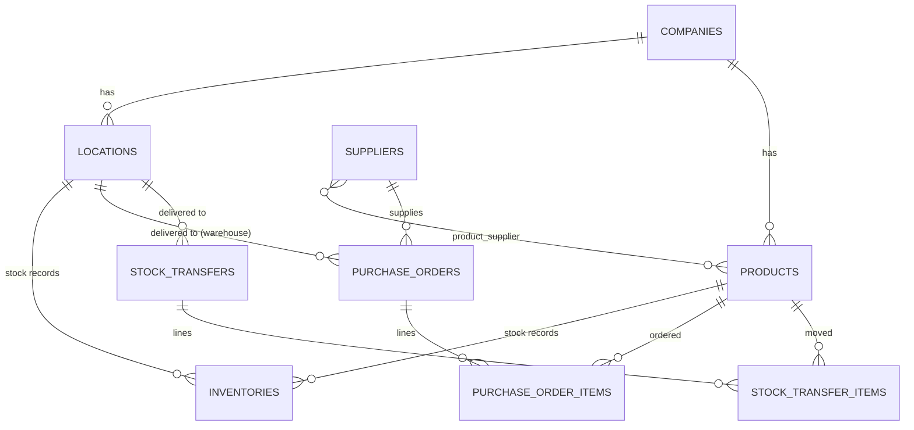

# Inventory Management System — Documentation

A Laravel 13 web application for managing companies, product categories, storage locations/stores, products, suppliers, purchase orders, stock transfers, and inventory levels — with role-based access for Super Admins, Business Admins, and Moderators.

This app shares its database with a companion **POS (point-of-sale) application** — see [Companion POS application](#companion-pos-application) in the Developer Guide.

This document has two parts:

- **[Part 1 — User Guide](#part-1--user-guide)** — how to use the application through the browser.
- **[Part 2 — Developer Guide](#part-2--developer-guide)** — how to set up, run, and extend the codebase.

---

## Part 1 — User Guide

### Signing in

- Go to `/login` to sign in, or `/register` to create a new account (name, email, alternative email, password). New self-registered accounts get the **Moderator** role and no company access until a Super Admin grants it — moderators can already sign in to the companion POS app.
- Forgot your password? Use **Forgot password?** on the login page — it emails a 6-digit code (valid 15 minutes) to your **alternative email** if you have one set, otherwise your primary email. Enter it on the reset page along with a new password.
- All pages except login/register/forgot-password/reset-password require you to be signed in.
- Success/status flash banners across the app (e.g. "Logged out successfully") auto-dismiss after 5 seconds; the **×** button on any banner closes it immediately.
- Use **Sign out** in the top-right of the navigation bar to log out. Signing in successfully always redirects to the **Dashboard**.

### Roles

| Role | Access |
|---|---|
| **Super Admin** | Everything — including Users management, deleting records, and editing Purchase Order delivery dates |
| **Business Admin** | Everything except Users management and record deletion |
| **Moderator** | Cannot access this app at all (`canAccessInventoryApp()` returns false) — moderators are POS-only cashiers/delivery staff |

Delete actions (Companies, Products, Locations, Inventory, Purchase Orders, Stock Transfers) are only visible/permitted for Super Admins; Business Admins can do everything else, including deactivating records via the toggle switch instead of deleting them.

### Navigation

The top navigation bar is organized into four dropdowns, plus a Dashboard link (the "Inventory System" logo/brand also links to the Dashboard):

| Dropdown | Contains |
|---|---|
| **General Data** | Companies, Locations, Suppliers, Categories, Base Units, Unit Conversions |
| **Inventory** | Products, Stock |
| **PO & Delivery** | Purchase Orders, Delivery Tracking |
| **Admin** | Reports, Activity Log, Users (Super Admin only) |

Your name/avatar in the top-right opens **My Profile**; the gear icon opens **Settings** — language, light/dark theme, **Contact Us**, **FAQ**, and **User Guide** (an in-app walkthrough and Q&A, cross-linked to each other via modals).

### Dashboard

The landing page after login (`/dashboard`). Shows:

- Five stat tiles: Active Products, Total Stock Units, Low Stock count, Pending Purchase Orders, Pending Stock Transfers.
- **Needs Attention** — up to 8 products at/below their reorder point, with product, location, current qty, and reorder point.
- **Pending Deliveries** — up to 6 pending Purchase Orders/Stock Transfers (same feed as Delivery Tracking).
- **Recent Activity** — the last 8 entries from the system-wide activity log.

### Companies

- **List**: `/companies`.
- **Create/Edit**: name only.
- **Active/Inactive toggle**: deactivating a company hides it from POS-facing pickers without deleting its history.
- **Delete**: Super Admin only; blocked with a clear message if the company still has products/locations/etc. tied to it.

### Locations

- **List**: `/locations` — has a live-filtering search box (company, name, description) and shows each location's **type**.
- **Create/Edit**: choose the owning **Company**, a **Type** (**Warehouse** or **Store**), a name, and an optional description.
  - **Warehouses** are the only locations Purchase Orders can be received into, and the only valid *source* for Stock Transfers to a store.
  - **Stores** are the only locations the companion POS app lets a cashier sell from or a Business Admin assign a cashier to.
- **Active/Inactive toggle** and **Delete** (Super Admin only, blocked if stock/sales exist).

### Suppliers

- **List**: `/suppliers` — name, contact person(s), phone(s), address, email.
- **Create/Edit**:
  - **Supplier Name**, **Address** (required).
  - **Contact Person** (required) and an optional **Additional Contact Person** — each has a name-prefix dropdown (Mr./Ms./Mrs./Dr./Engr./Atty.) stored combined with the name (e.g. "Mr. Juan Dela Cruz").
  - **Phone** (required) and an optional **Secondary Phone** — each pairs a country-code dropdown (Philippines +63 first) with a **9-digit local number** (digits only, enforced live in the input and again server-side via `regex:/^[0-9]{9}$/`).
  - **Email** (optional).
- **Delete**: warns explicitly ("There are products supplied by this supplier...") if any active product currently lists this supplier before confirming; deleting removes the supplier→product links (products themselves are untouched) since suppliers cascade-delete only their pivot rows, not products.

### Products

- **List**: `/products` — SKU, Name, Description, Company, **Supplier** (first linked supplier + "+N" if more, hover for the full list), Category, Base Unit (with any unit-conversion total shown underneath), Reorder Point, Status, and actions.
- **Create** (`/products/create`) / **Edit**:
  1. Choose **Company** and **Category**.
  2. Enter **Product Name**, optional **Description**, a unique **SKU**.
  3. Enter **Unit Value / Qty** and pick a **Base Unit**.
  4. Pick **at most one Applicable Unit Conversion** (radio buttons, including an explicit "None") — a product can only ever have one conversion active, even though the same base unit may have several conversions defined globally.
  5. Check off any **Suppliers** this product can be ordered from (multi-select) — this is what the Purchase Order form filters against.
  6. Enter **Reorder Point**, **Selling Price**, and optional **Cost** (cost pre-fills a Purchase Order line's Unit Cost).
  7. Optionally upload a product **Photo**.
  8. Save.
- **Active/Inactive toggle** (all roles) and **History** (per-product activity log).
- **Delete** (Super Admin only) is guarded on two levels:
  - Blocked outright, with a clear message, if the product still has **stock on hand** (`inventories.quantity > 0`) — its stock rows would otherwise cascade-delete silently.
  - The delete button shows a stronger warning ("...linked to active purchase orders or inventory records...") if the product has stock, a pending Purchase Order line, or a pending Stock Transfer line; a plain confirmation otherwise. Pending PO/Transfer line items are also protected at the database level (no cascade), so an attempt against those surfaces a friendly error rather than a crash.

### Categories

- **List**: `/categories`. **Create**: choose the owning **Company**, enter a name.

### Base Units & Unit Conversions

- **Base Units** (`/base-units`): unit of measure name + short code (e.g. "Kilogram" / "kg"). **Delete** is blocked if any active product currently uses it.
- **Unit Conversions** (`/unit-conversions`): defines "1 `<from unit>` = `<factor>` `<to unit>`" (e.g. "1 Box = 12 Piece"); more than one conversion can exist for the same base unit. **Delete** is blocked if any active product currently has this conversion selected.

### Stock (Inventory)

- **List**: `/inventory` — product, location (with type shown), quantity.
- **Create/Edit**: choose a Product and Location, enter Quantity. Each product can only have one stock record per location.
- **Transfer** (instant, same-company): pick a source location that currently has stock of this product (live "available" badge, quantity capped, source excluded from the destination list), and a destination — creates the destination's stock record automatically if needed. Runs in a single DB transaction.
- Shared with the companion POS app's own Stock page — a change in either app is immediately visible in the other.

### Purchase Orders

- **List**: `/purchase-orders`.
- **Create**: pick **Supplier** first (required) — filters the Company and the Product list to only what that supplier provides — then **Company**, then **Deliver To (Warehouse)** (warehouse-type locations only). Set **Order Date** and a required **Expected Delivery Date**, optional Notes, then add one or more product rows (Quantity, Unit Cost — pre-filled from the product's Cost but editable). If a chosen supplier has no linked products for that company, the product dropdown says so explicitly instead of appearing empty/broken.
- **Show** (`/purchase-orders/{id}`): a compact metadata bar (Status, Supplier, Company, Warehouse, dates, Created/Received By) with a collapsible **Supplier Details** drawer, a full-width **Order Items** table, and a full-width **Stock Activity** log of what was received.
- **Mark as Received**: updates stock at the destination warehouse immediately, in a transaction; logs a `purchase_received` activity entry.
- **Cancel**: marks the order cancelled without touching stock.
- **Delete**: Super Admin only.

### Stock Transfers

Distinguishes **instant** (store↔store, applied immediately) from **deferred/tracked** (warehouse→store, goes through a pending → received/cancelled lifecycle, same as Purchase Orders) transfers. Tracked transfers appear in Delivery Tracking and the Dashboard's Pending Deliveries alongside Purchase Orders.

### Delivery Tracking

- **List**: `/deliveries` — a unified feed of pending/received/cancelled Purchase Orders and tracked Stock Transfers (via the shared `DeliveryFeed` support class), with each row's type, status, warehouse/location type, and dates.
- **Export to Excel**: downloads the current list as CSV.
- **Edit dates** (Super Admin only): adjust a Purchase Order's Order/Expected Delivery dates from its show page.

### Users (Super Admin only)

- **List**: `/users`.
- **Create/Edit**: Full Name, Email, optional Alternative Email (**required** if you're also setting a password, so reset codes have somewhere to go), Role, one or more **Companies**, and (for Moderators) a single **POS Location**.
- **Active/Inactive toggle** and **Delete** — you can't deactivate/delete/demote-from-Super-Admin your own currently-signed-in account.

### Profile

`/profile` — every signed-in user can update their own name, email, alternative email, avatar photo, and password (old password fields plus the same "alternative email required with a new password" rule as Users). Avatar and password fields have their own full-width rows; identity and role/company fields sit side-by-side above them.

### Reports & Activity Log

- **Reports** (`/reports`): stock/sales summaries.
- **Activity Log** (`/history`): every create/update/delete/transfer/purchase-received/transfer-dispatched/received/cancelled event system-wide, with **Export to Excel**.
- Every module with a History link (Products, Inventory, Purchase Orders, Stock Transfers) shows the same activity entries scoped to that one record.

---

## Part 2 — Developer Guide

### Tech stack

- **Backend**: Laravel 13, PHP 8.3+
- **Database**: Microsoft SQL Server (`sqlsrv` driver) for local development; tests run against in-memory SQLite (see `phpunit.xml`)
- **Frontend**: Server-rendered Blade views styled with **Bootstrap 5** (CDN, in `resources/views/layouts/app.blade.php`) and Bootstrap Icons. Vite/Tailwind are scaffolded in `package.json` but are not the source of the actual UI styling.
- **Auth**: Laravel's built-in session-based guard (`AuthController`, `Auth::attempt`), plus a custom `role:` route middleware (`app/Http/Middleware/EnsureRole.php`) for Super-Admin-only routes.

### Requirements

- PHP 8.3+
- Composer
- Node.js (for Vite asset building, optional for basic use)
- SQL Server (with an ODBC Driver 17 for SQL Server) for local dev, or adjust `.env` to use SQLite/MySQL

### Installation & setup

```bash
composer install
cp .env.example .env
php artisan key:generate
```

Edit `.env` and set your database connection. For SQL Server (used in local development):

```
DB_CONNECTION=sqlsrv
DB_HOST=YOUR_HOST\SQLEXPRESS
DB_PORT=
DB_DATABASE=inventory
DB_USERNAME=
DB_PASSWORD=
```

Then run migrations and (optionally) seed sample data:

```bash
php artisan migrate
php artisan db:seed
```

Install frontend dependencies (only needed if you touch `resources/css`/`resources/js`):

```bash
npm install
npm run build
```

### Running the app

```bash
composer run dev
```

This runs `php artisan dev`, which starts the Laravel server, queue listener, and Vite dev server together. Alternatively, `php artisan serve` on its own is enough since the UI doesn't depend on compiled assets.

### Running tests

```bash
composer run test
# or
php artisan test
```

Tests always run against an in-memory SQLite database (forced by `phpunit.xml`), independent of whatever `.env` is configured for local dev.

### Code style

```bash
vendor/bin/pint
```

### Architecture

**Routing & auth** (`routes/web.php`): a `guest` middleware group holds `/login`, `/register`, `/forgot-password`, `/reset-password`; everything else sits behind `auth`. Most modules are standard `Route::resource(...)` calls; delete routes and the Users resource are wrapped in a `role:super_admin` group. Root `/` redirects to `dashboard.index`.

**Roles** (`app/Models/User.php`): `role` is one of `super_admin` / `business_admin` / `moderator` (constants `User::ROLE_*`), checked via `isSuperAdmin()`/`isBusinessAdmin()`/`isModerator()`/`canAccessInventoryApp()`.

**Data model — key tables added since the original schema:**

| Model | Table | Notes |
|---|---|---|
| `Supplier` | `suppliers` | `belongsToMany` `Product` via `product_supplier` (cascade-deletes the pivot, not products) |
| `PurchaseOrder` / `PurchaseOrderItem` | `purchase_orders` / `purchase_order_items` | Status `pending`/`received`/`cancelled`; items have a plain FK to `products` (no cascade — blocks product deletion while referenced) |
| `StockTransfer` / `StockTransferItem` | `stock_transfers` / `stock_transfer_items` | Same status lifecycle as Purchase Orders for warehouse→store transfers; store↔store transfers apply instantly with no tracked row |
| `UnitConversion` | `unit_conversions` | `hasMany` `Product` via `products.unit_conversion_id` (single nullable FK — **not** a pivot; see Known Issues below for why) |
| `Location.type` | `locations.type` | `warehouse` or `store` (`Location::TYPE_WAREHOUSE`/`TYPE_STORE`); `isWarehouse()`/`isStore()` helpers gate PO-receiving and POS location pickers |
| `Product.unit_conversion_id` | `products` | Nullable FK — each product selects at most one conversion, even if several exist for its base unit |



**SQL Server quirks to be aware of:**

- Several models hardcode `company_id` as both the local and foreign key in relationships, since `companies.company_id` isn't the Eloquent-default `id`.
- Cascade deletes were deliberately removed wherever two columns on the same table would reference the same other table twice (SQL Server's "multiple cascade paths" error) — e.g. `purchase_orders.created_by`/`received_by`, `stock_transfers.created_by`/`received_by` both reference `users` with no cascade.
- An inline closure with an array literal as the sole argument to `@json(...)` in a Blade view confuses Blade's bracket-balance pre-check (`Unclosed '[' does not match ')'`, pointing at the *compiled* file). Always pre-build the plain array in the controller (see `ProductController::conversionOptions()`, `PurchaseOrderController::create()`'s `$productOptions`/`$locationOptions`) and pass a plain variable to `@json()`.

### Delete safety

Every `destroy()` that could be blocked by real references follows this pattern — catch the DB's rejection and turn it into a plain-language flash error instead of a 500 page:

```php
try {
    $model->delete();
    return redirect()->route('...')->with('success', '...');
} catch (\Illuminate\Database\QueryException $e) {
    if ($e->getCode() == '23000' || str_contains($e->getMessage(), 'REFERENCE constraint')) {
        return redirect()->route('...')->with('error', 'Cannot delete this ... because ...');
    }
    throw $e;
}
```

Some deletions are additionally pre-checked *before* attempting the delete, so the user gets a specific reason without relying on the DB error message at all — `UnitOfMeasureController::destroy()` and `UnitConversionController::destroy()` check for active products first; `ProductController::destroy()` checks for on-hand stock first (since that FK cascades and wouldn't otherwise raise an error). The Products and Suppliers list pages also pass a `hasActiveDependencies`/`active_products_count` flag to the delete button's confirmation JS so the warning text itself changes before the request is even sent.

`InventoryController::destroy()` deliberately has no such guard — nothing in the schema holds a foreign key against `inventories.id`.

### Flash banners

Success/status alerts across the authenticated layout (`resources/views/layouts/app.blade.php`) carry `data-auto-dismiss="5000"` and are closed via `bootstrap.Alert.getOrCreateInstance(el).close()` after that delay; the standalone auth pages (login/forgot-password/reset-password, which don't load Bootstrap's JS bundle) use a small hand-rolled fade+remove script instead, with the same 5s timer and immediate manual dismiss via the **×** button (which cancels the timer). Error/warning alerts are *not* auto-dismissed. If you add a new success/status banner anywhere, follow whichever of these two patterns matches the page it's on.

### Known Issues

- `UnitConversion` used to be a `belongsToMany` via a `product_unit_conversions` pivot (multi-select per product); this was deliberately reversed to a single nullable `products.unit_conversion_id` FK (migration `2026_09_08_080000_replace_product_unit_conversions_pivot_with_single_fk`) so a product can only ever have one applicable conversion. If you're reading old code/docs referencing `product_unit_conversions`, it no longer exists.
- Two separate migrations created similarly-named tables early in the project's history — `base_units` and an unrelated, unused `unit_of_measures` table, plus a separate empty `categories` table distinct from `product_categories`. These are historical leftovers; live features use `base_units` and `product_categories`. See `CLAUDE.md` for the full list of naming quirks.
- There is no company-scoping in this app's own queries — every signed-in user with access sees every company's data, regardless of which companies their account is assigned to. The companion POS app enforces its own scoping via `users.company_id`/`company_user`, but this app's controllers don't filter by it.
- The `inventories` table has two overlapping quantity columns (`quantity_on_hand` and `quantity`, the latter added later); this app's own code only reads/writes `quantity`. The companion POS app treats whichever is larger as the true on-hand count and writes both back in sync — see its docs.

### Companion POS application

A separate Laravel 13 app (`POS/POS/`) implements a point-of-sale register on the same database — same SQL Server connection, same `companies`/`locations`/`products`/`inventories`/`users`/`suppliers` tables, no API or sync step. It owns `sales`, `sale_items`, `refunds`, `refund_items` exclusively.

Because the two apps share one `migrations` table, each app's default Laravel migrations are only ever applied once — whichever app runs `php artisan migrate` first "wins".

Practical implications for anyone working on this codebase:

- **Don't drop or rename `products.selling_price`/`cost`, `inventories.quantity`/`quantity_on_hand`, `locations.type`, or any `suppliers`/`purchase_order*`/`stock_transfer*` column** without checking whether POS reads it — its Stock and Team pages both rely on `locations.type` (stores only) and the shared `users`/`companies` structure.
- A user account is shared: signing up, logging in, resetting a password, or changing a role here affects both apps identically, since it's the exact same `users` row.
- If you add a migration that alters `products`, `inventories`, `locations`, `companies`, `users`, or `suppliers`, mention it to whoever maintains the POS app (or check its `DOCUMENTATION.md`) — those tables are load-bearing for checkout, stock deduction, refunds, and team/location assignment over there.
